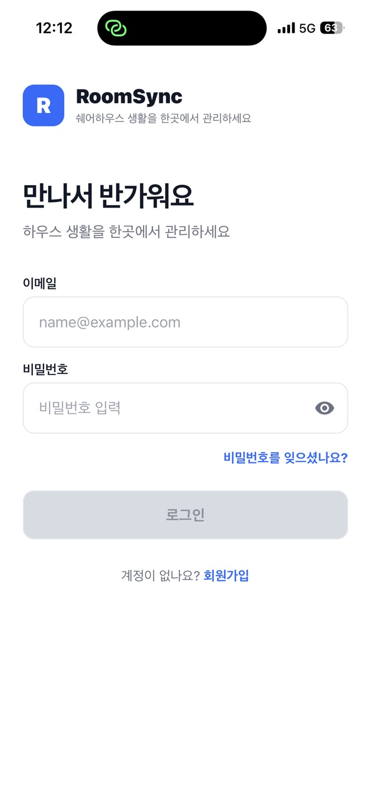
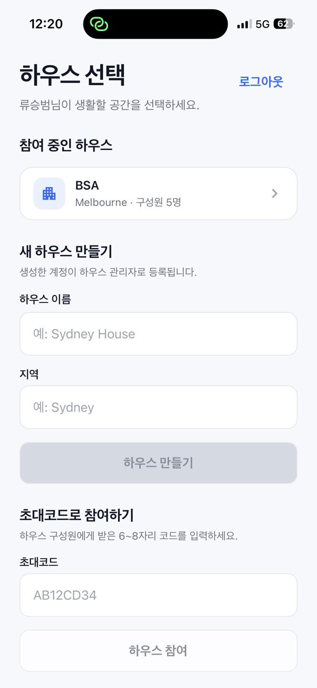
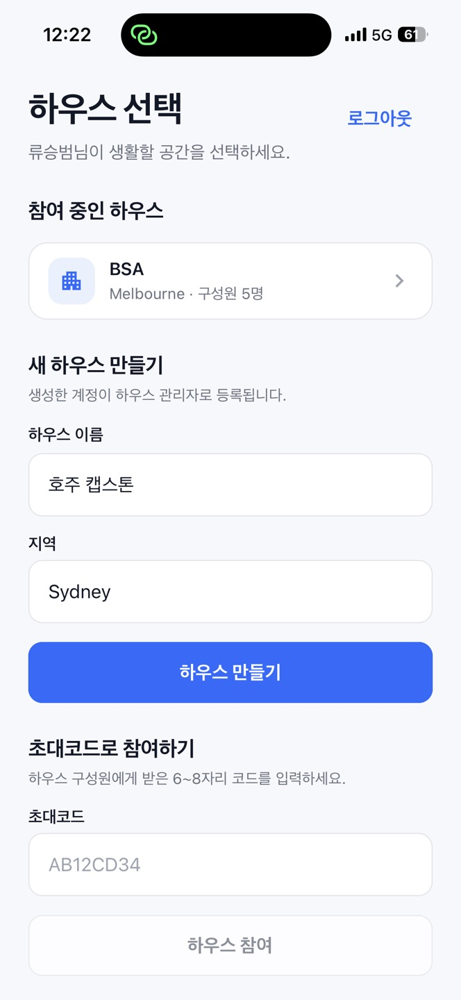
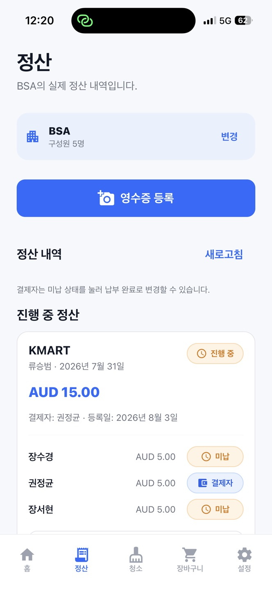
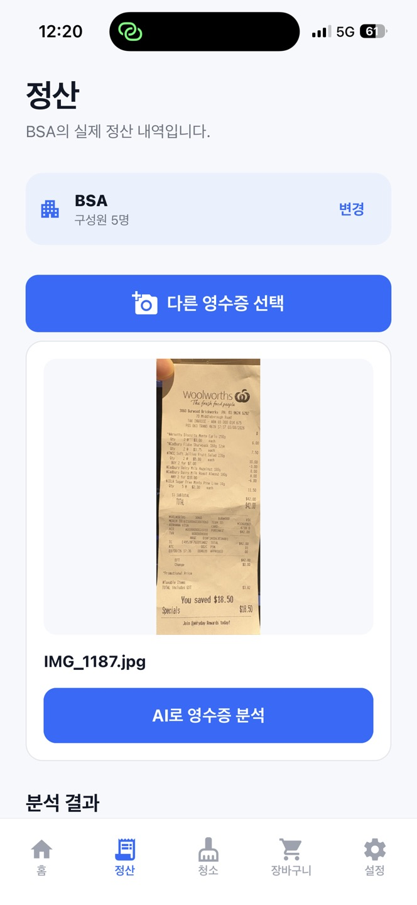
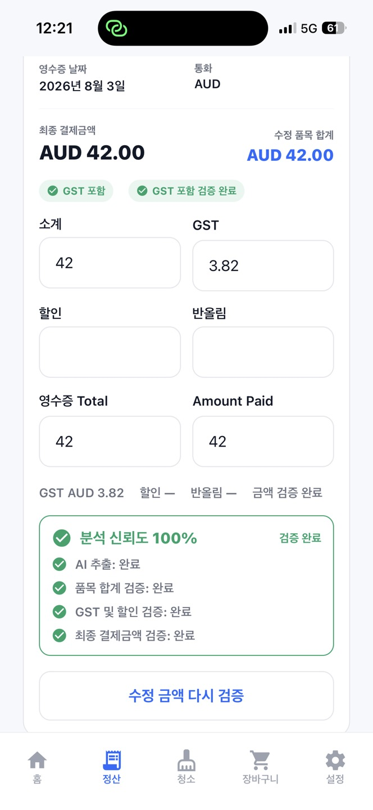
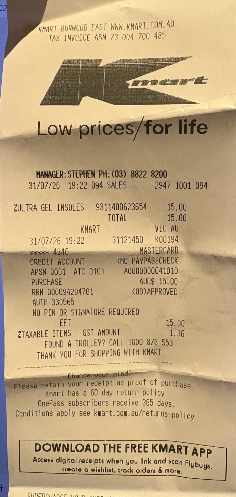
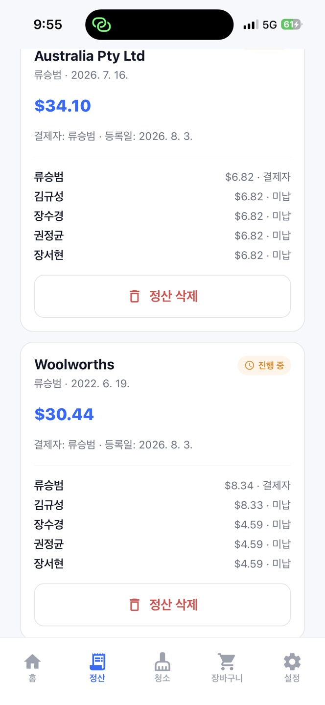
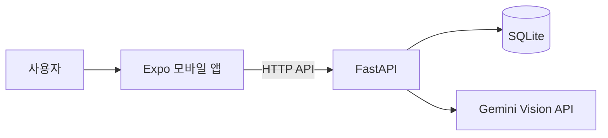

# RoomSync

쉐어하우스 공동생활 관리 앱. 교육 프로그램 최종 프로젝트 결과물.

영수증 사진을 올리면 AI가 품목과 금액을 읽어 줌. 사용자가 결과를 확인하고 품목마다 같이 낼 사람을 고르면 1인당 분담금을 센트 단위로 계산함. 청소 당번과 공동 장보기 목록도 같은 하우스 안에서 같이 관리함.

## 왜 만들었나

쉐어하우스에서 반복되는 일은 셋으로 정리함.

1. 공용 장보기 영수증을 사람 수대로 나누기. 개인 품목이 섞여 있고 할인 라인과 GST 표기가 영수증마다 다름
2. 누가 이미 돈을 보냈는지 기억하기
3. 청소 당번과 장볼 목록을 단톡방 메시지로만 주고받음

## 어떻게 푸나

**사용자는 찍고, 확인하고, 고르기만 함. 계산은 앱과 서버가 맡음.**

| 단계 | 하는 일 | 누가 |
|---|---|---|
| 1. 하우스 만들기 | 하우스를 만들고 초대 코드로 멤버를 부름 | 사용자 |
| 2. 영수증 업로드 | 사진을 올리면 매장, 날짜, 품목, 할인, GST, 총액을 읽음 | AI (Gemini Vision) |
| 3. 금액 검증 | 품목 합계와 할인, GST, 총액이 서로 맞는지 확인하고 안 맞으면 경고 | 서버 |
| 4. 품목 확인 | 잘못 읽은 품목을 고치고 품목마다 공용/개인과 참여자를 고름 | 사용자 |
| 5. 분담금 계산 | 할인을 해당 품목 참여자에게 나눠 붙이고 1인당 금액을 센트 단위로 확정 | 서버 |
| 6. 납부 관리 | 결제자가 멤버별 납부 여부를 체크 | 사용자 |

영수증을 받아 든 사람의 일이 "계산기로 나누고 단톡방에 공지"에서 "사진 찍고 참여자 고르기"로 줄어드는 게 목표.

## 화면

### 1. 시작

| 로그인 | 하우스 선택 | 하우스 만들기 |
|:---:|:---:|:---:|
|  |  |  |
| 이메일과 비밀번호. 계정이 없으면 회원가입 | 참여 중인 하우스를 고르거나 초대 코드(6~8자리)로 참여 | 이름과 지역을 넣으면 만든 사람이 관리자가 됨 |

### 2. 영수증 정산

| 정산 탭 | 영수증 선택 | AI 분석 결과 |
|:---:|:---:|:---:|
|  |  |  |
| 영수증 등록 버튼과 진행 중 정산. 멤버별 미납과 결제자 표시 | 고른 영수증을 미리 보고 AI 분석 시작 | 소계, GST, 할인, 총액을 검증하고 분석 신뢰도 표시. 고친 금액은 다시 검증 |

| 실제 영수증 | 정산 내역 |
|:---:|:---:|
|  |  |
| 실제 Kmart 영수증. 정산 탭의 KMART AUD 15.00 건(3명이 5.00씩)이 이 영수증 | 멤버별 분담금과 납부 상태. 나누어 떨어지지 않으면 1센트 차이가 남($8.34, $8.33) |

## 주요 기능

**계정, 하우스**

- 회원가입과 로그인, 로그아웃, 회원 탈퇴.
- 하우스 생성과 초대 코드로 참여. 하우스 나가기와 방장 넘기기.
- 하우스 멤버가 아니면 그 하우스의 정산과 청소, 장보기 데이터를 서버에서 거절함(403).

**영수증 정산**

- 영수증 사진을 서버에서 EXIF 방향대로 돌리고 긴 변 1800px로 줄여 AI에 보냄.
- AI는 Gemini 기본, OpenAI 선택 가능. API 키 없이 시연할 때는 mock 모드.
- 호주 영수증 기준으로 GST 포함 여부를 확인함. 영수증에 GST가 안 찍혀 있으면 1/11로 추정하지 않고 경고만 띄움.
- 할인과 쿠폰 라인은 음수로 두고 연결된 품목의 참여자에게만 나눠 붙임. 영수증 아래쪽 "You saved" 같은 요약 줄은 다시 빼지 않음.
- 분담금은 센트 정수로 계산하고 저장함. 나누어 떨어지지 않는 1센트는 정해진 규칙으로 돌아가며 붙여 총액이 항상 영수증과 같음.
- 정산 내역과 멤버별 납부 상태 확인.

**청소, 장보기**

- 청소 일정 등록과 담당자 지정, 완료 처리.
- 공동 장보기 항목 등록과 구매 완료 표시.

## 기술

### 구조



스마트폰의 Expo Go 앱이 같은 Wi-Fi에 있는 PC의 FastAPI 서버를 부름. AI 키는 서버에만 있고 앱에는 없음.

### 기술 선택과 이유

| 기술 | 고른 이유 | 한계 |
|---|---|---|
| React Native, Expo SDK 54, Expo Router | 빌드 없이 Expo Go로 팀원 폰에서 바로 확인. 파일 경로가 곧 화면 경로 | 실제 배포는 EAS 빌드가 따로 필요 |
| FastAPI, Pydantic | 요청과 AI 응답을 스키마로 검사. `/docs`에 API 문서가 자동으로 생김 | 서버를 PC에서 직접 띄워야 함 |
| SQLite | 설치 없이 파일 하나로 동작. 시연과 테스트에 충분 | 동시 쓰기에 약함. 배포 시 PostgreSQL로 바꿀 계획 |
| Gemini Vision | 사진에서 품목 표를 JSON으로 바로 받음 | 촬영 상태에 따라 결과가 달라서 사용자 확인 단계를 둠 |

### 핵심 구현

- **금액 검증**: AI가 읽은 품목 합계, 할인, 수수료, 반올림, GST, 총액의 관계를 서버가 다시 맞춰 봄. 맞으면 검증 점수를 올리고 안 맞으면 어느 값이 어긋나는지 경고로 돌려줌.
- **센트 분배**: 금액을 `Decimal`로 받아 센트 정수로 바꾼 뒤 나눔. 할인은 품목 금액 비율로 나누고 남는 센트는 나머지가 큰 쪽부터 붙임. 1/n로 안 떨어지는 금액은 참여자 조합마다 순번을 돌려 같은 사람이 매번 1센트를 더 내지 않게 함.
- **AI 응답 검사**: 응답에서 JSON만 뽑아 Pydantic 모델로 검사함. 품목은 1~100개, 타입은 item/discount/coupon/refund/fee/tax/unknown 중 하나. 일시적인 Gemini 오류는 최대 2번 다시 시도함.
- **요청 시간 제한**: 앱의 API 호출은 기본 15초 후 끊고 네트워크 오류와 시간 초과를 나눠 안내함.

### 보안

- 비밀번호는 PBKDF2-SHA256(60만 회, 사용자별 salt)으로 저장하고 비교는 `hmac.compare_digest`로 함.
- 로그인 토큰은 무작위 32바이트. DB에는 SHA-256 해시만 저장함.
- API 키와 `.env`, 실행 DB, 실제 영수증 이미지는 Git에 올리지 않음.

### 쓴 기술

- 앱: React Native, Expo SDK 54, Expo Router, TypeScript
- 서버: Python, FastAPI, Uvicorn, Pydantic, Pillow
- 데이터: SQLite
- AI: Google Gemini Vision, OpenAI(선택)
- 테스트: pytest, ESLint, TypeScript

### 파일 구조

```text
frontend/                 Expo 모바일 앱
  app/(auth)/             로그인, 회원가입
  app/(tabs)/             홈, 정산, 청소, 장보기, 설정 탭
  app/house-select.tsx    하우스 선택
  components/             공통 UI (영수증 분석 편집기 포함)
  contexts/               로그인 상태
  services/api.ts         FastAPI 호출, 시간 제한
  utils/                  금액 표시, 정산 합계 계산
backend/                  FastAPI 서버
  app/main.py             API 경로
  app/database.py         SQLite 테이블과 CRUD
  app/receipt_analyzer.py 이미지 전처리, AI 호출, 금액 검증, 센트 분배
  app/security.py         비밀번호 해시, 토큰
  scripts/                DB 준비
  tests/                  pytest
app.py, database.py       초기 Streamlit 프로토타입
docs/                     발표자료, 보고서, 시연 자료
```

## 실행

준비물: Git, Node.js LTS, Python 3.11 이상, 스마트폰의 Expo Go, (실제 AI 분석 시) Gemini API 키.

비공개 저장소라 접근 권한이 있는 GitHub 계정이 필요함.

```powershell
git clone https://github.com/ryusb2295/roomsync.git
cd roomsync
```

### 1. 백엔드

```powershell
python -m venv backend\.venv
backend\.venv\Scripts\python.exe -m pip install -r backend\requirements.txt
Copy-Item backend\.env.example backend\.env
```

`backend/.env`에서 분석 방식을 고름.

```env
# 실제 Gemini 분석
ROOMSYNC_RECEIPT_PROVIDER=gemini
GEMINI_API_KEY=발급받은_API_키
ROOMSYNC_GEMINI_MODEL=gemini-3.1-flash-lite
ROOMSYNC_RECEIPT_MOCK_ENABLED=false

# 키 없이 시연 (mock)
# ROOMSYNC_RECEIPT_PROVIDER=mock
# ROOMSYNC_RECEIPT_MOCK_ENABLED=true
```

DB를 준비하고 서버를 띄움.

```powershell
backend\.venv\Scripts\python.exe -m backend.scripts.prepare_database
backend\.venv\Scripts\python.exe -m uvicorn backend.app.main:app --host 0.0.0.0 --port 8001 --reload
```

[127.0.0.1:8001/health](http://127.0.0.1:8001/health)가 열리면 정상. API 문서는 [127.0.0.1:8001/docs](http://127.0.0.1:8001/docs). 자세한 설정은 [backend/README.md](backend/README.md).

### 2. 앱

폰과 PC를 같은 Wi-Fi에 연결하고 `ipconfig`로 PC의 IPv4 주소를 확인함.

```powershell
Copy-Item frontend\.env.example frontend\.env.local
```

`frontend/.env.local`의 주소를 PC IP로 바꿈. 폰에서는 `localhost`가 PC를 가리키지 않음.

```env
EXPO_PUBLIC_API_URL=http://YOUR_PC_IP:8001
EXPO_PUBLIC_ROOMSYNC_DEMO_MODE=false
```

새 PowerShell 창에서 실행하고 터미널의 QR 코드를 Expo Go로 찍음.

```powershell
cd frontend
npm install
npx expo start -c
```

### 테스트

```powershell
backend\.venv\Scripts\python.exe -m pytest backend\tests -q
cd frontend; npm run lint; npx tsc --noEmit
```

## 안 될 때

| 증상 | 확인할 것 |
|---|---|
| `Network request failed` | 폰과 PC가 같은 Wi-Fi인지, `EXPO_PUBLIC_API_URL`의 IP와 포트가 맞는지 |
| API 주소를 바꿨는데 그대로임 | `npx expo start -c`로 캐시 비우기 |
| Windows 방화벽 경고 | Python과 Node.js의 사설 네트워크 통신 허용 |
| 학교, 공용 Wi-Fi에서 연결 안 됨 | 기기 간 통신이 막혀 있을 수 있음. 개인 핫스팟 사용 |
| AI 분석 실패 | `backend/.env`의 provider와 API 키, 모델명. 시연만 필요하면 mock 모드 |

## 한계와 다음 계획

- 서버와 DB가 로컬 PC에서 돌아서 폰과 PC가 같은 네트워크에 있어야 함.
- 영수증 형식과 촬영 상태에 따라 AI 결과가 달라짐. 그래서 저장 전에 사용자가 꼭 확인하게 함.
- 실제 송금과 푸시 알림은 아직 없음.
- 다음 계획: FastAPI 클라우드 배포, PostgreSQL 전환, 실시간 동기화, 푸시 알림, 송금 서비스 연계.

## 팀

| 팀원 | 담당 |
|---|---|
| 류승범 | 조장, 백엔드, Gemini, 데이터베이스, 최종 통합 |
| 김규성 | QA, 테스트, 문서화 |
| 권정균 | 프런트 구조, 인증, 하우스, API 연결 |
| 장서현 | 영수증 결과, 참여자 선택, 정산 UI |
| 장수경 | 청소 일정, 공동 장보기 |
